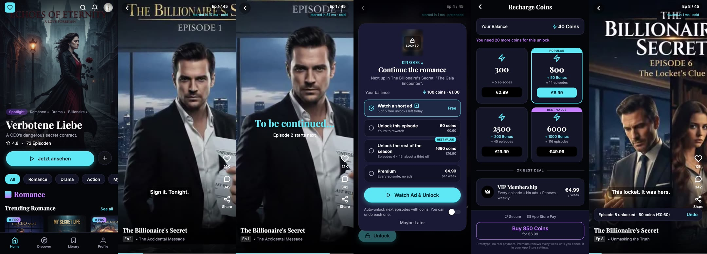

# DramaFlash beta prototype

Round 2, Option A, for the TargetVideo Mobile App Developer role. Built in React Native from the screen design you sent.

**Live:** https://sabuhiteymurov.github.io/dramaflash-prototype/ (best in a phone-sized window)
**Demo video (iPhone simulator, 101 s):** https://sabuhiteymurov.github.io/dramaflash-prototype/demo.mp4



## What to try

1. Open *The Billionaire's Secret* and press *Play Ep 1*. Episodes 1 to 3 play back to back.
2. Episode 3 ends on a cliffhanger. Episode 4 is locked and the unlock sheet opens over it.
3. Unlock with a short ad (5 a day) or with coins. You start with 100 coins and an episode costs 60. The second unlock sends you to the coin store.
4. Switch on auto-unlock in the sheet. The next locked episode then unlocks by itself and shows an Undo.
5. *Profile → Event log* lists what the app would send to analytics. The pill under the episode counter shows how fast each episode started.

## Three decisions

### 1. The ad is the default way to unlock

TargetVideo's business is video advertising, and this market is moving toward ads. In China, free ad-supported viewing passed half of the micro-drama market by December 2024 [1]. The sheet opens with *Watch a short ad* already selected. Coins are the fast lane for people who don't want to wait.

Ad unlocks are capped at 5 a day. Without a cap, coins would have no reason to exist. In production the server owns the cap and the grant, and it unlocks only after the ad network's reward callback arrives.

### 2. Trust is part of the product

These apps win and lose users over money. ReelShort has 4.7 stars on the US App Store and 1.6 on Trustpilot [2]. The complaints there are weekly renewals, coin prices that change, and coins spent without asking. I designed against each one.

- Every coin price shows its euro value. The EU consumer authorities asked for exactly that for virtual currencies in March 2025 [3].
- The store says how many episodes each pack buys.
- Auto-unlock is off by default. When it's on, every automatic unlock comes with Undo.
- Premium says "renews every week" next to the price, not in the fine print.

An episode costs 60 coins, about €0.60, close to ReelShort's 60 coins [4]. The rest of a season is about a third cheaper than buying it episode by episode.

### 3. The feed runs on three players

A drama has 50 to 100 episodes. One player per episode would grow memory and decoder use with every swipe, and some Android phones give an app a single hardware decoder. The feed owns three players instead. Page *i* borrows player *i % 3*. The previous, current and next episodes each have one. The next episode buffers while you watch. Locked episodes get none.

The active page only changes once a page is 80% on screen, never halfway through a swipe. The pill under the counter shows the time from the end of a swipe to playback, and whether that episode was preloaded. That is the first number I'd put on a dashboard.

## Your player SDK

I read `TargetVideo/react-native-bridtv-sdk-module`. Issue #68, opened on 15 October, describes three problems on iOS with the New Architecture.

- The player reads its settings too late.
- Some state is shared between player instances.
- Every component receives every player's events.

One player per screen won't notice. A swipe feed needs three at once.

In my first week I'd build the feed twice, once on expo-video and once on the Brid SDK. I'd measure time to playback and memory on a cheap Android phone. If Brid wins, I'd make its state per-instance first.

## What I'd measure

- Time from swipe to playback, p50 and p90, split into preloaded and cold. Rebuffer percentage.
- Paywall views that end in an unlock, by method (ad, coins, season, Premium) and by trigger (cliffhanger or tap).
- The share of viewers who start the next episode within 10 seconds of a cliffhanger.
- Whether free ad unlocks cut coin revenue. The daily cap is the variable to test.
- D1 and D7 retention. The top 200 short-drama apps average 26.9% and 8.6% [5].

## What I left out on purpose

- **Not built:** login, real payments, a real ad SDK, a CMS and audio.
- **Free episodes:** 3 instead of the usual 9 or so [4]. You reach the paywall within a minute.
- **Entitlements:** coins and unlocks live in memory. In production the server owns them and the app only displays them.

## How I built it

Expo SDK 58, React Native 0.88 (New Architecture), TypeScript, Expo Router and expo-video. I used Claude Code to move faster. A Playwright script clicks through the whole flow on the production build after every change. The episodes are nine-second clips I rendered from your key art.

```bash
npm install
npx expo start          # w for web
npm run typecheck
npm run export:web      # static build in dist/, as deployed
```

## Sources

1. Caixin, 22 Aug 2025. https://www.caixinglobal.com/2025-08-22/in-depth-micro-drama-platforms-knock-down-paywalls-as-viewers-lose-interest-102354440.html
2. Trustpilot and the US App Store, as compared by Filmustage, 2026. https://filmustage.com/blog/short-drama-apps-compared-reelshort-vs-dramabox-in-2026/
3. CPC Network, Key principles on in-game virtual currencies, 21 Mar 2025. https://commission.europa.eu/document/download/8af13e88-6540-436c-b137-9853e7fe866a_en
4. ReelShort coin guide (https://www.reelshort.com/fandom/reelshort-coins-01-25-3faa2218/) and GASP, cost to finish a short drama (https://geekvibesnation.com/cost-to-finish-short-drama).
5. Sensor Tower, quoted by adjoe. https://adjoe.io/blog/short-drama-apps-rewarded-engagement/

Sabuhi Teymurov · hello@sabuhiteymurov.com
